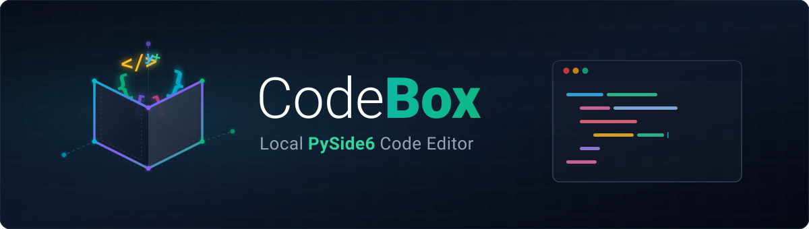
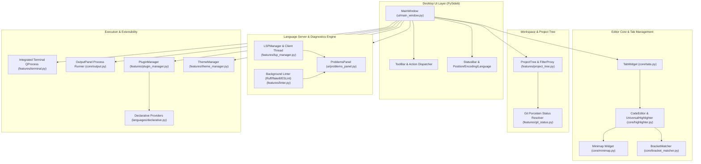
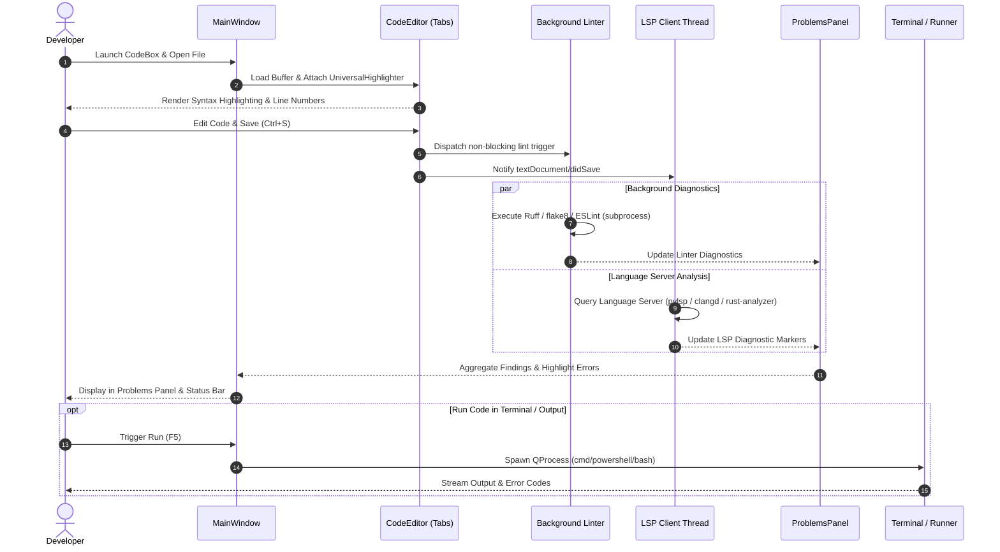
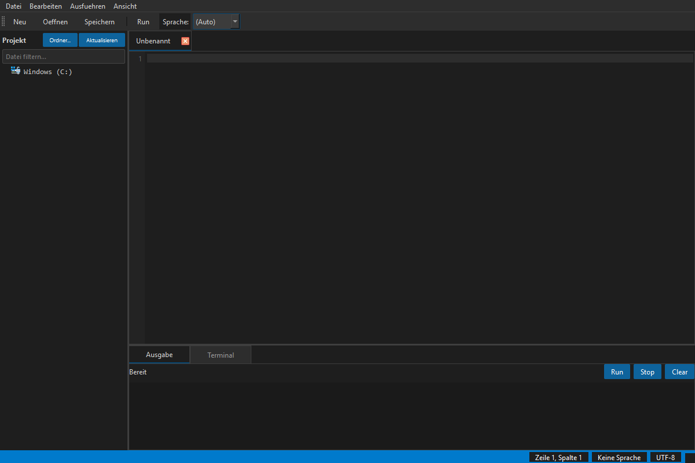

# CodeBox — Éditeur de code de bureau PySide6 privilégiant le local

[](LICENSE)
[](NOTICE)
[](https://www.python.org/)
[]()
[](https://github.com/dev-bricks/CodeBox/actions/workflows/ci.yml)
[]()
[](SECURITY.md)
[](SECURITY.md)
[](https://github.com/dev-bricks)
[](https://github.com/open-bricks)
[]()
[](CHANGELOG.md)
[](THIRD_PARTY_LICENSES.md)
[](llms.txt)
[](llms.txt)

[English](README.md) | [Deutsch](README_de.md) | [Español](README.es.md) | [简体中文](README.zh.md) | [日本語](README.ja.md) | [Русский](README.ru.md) | Français
> Cette version traduit uniquement la documentation. CodeBox propose toujours une interface utilisateur en six langues : allemand, anglais, espagnol, chinois, japonais et russe.

CodeBox est un IDE de bureau privilégiant l’exécution locale, conçu pour les développeurs Windows, Linux et macOS qui recherchent un éditeur de code PySide6 léger avec un espace de travail à plusieurs onglets, une arborescence de projet, un terminal intégré, des indicateurs d’état Git au format porcelain, la coloration syntaxique, les diagnostics du Language Server Protocol (LSP) et une architecture extensible de plugins de langage en JSON et Python.

> [!NOTE]
> Pour le contexte destiné aux agents d’IA et à la découverte automatisée, consultez [llms.txt](llms.txt), qui fournit des informations lisibles par machine, des résumés de l’architecture et des liens de navigation.

---

## Navigation rapide

- [1. Pour commencer](#start-here)
- [2. Architecture du système](#system-architecture)
- [3. Cycle de vie complet du flux de travail](#end-to-end-workflow-lifecycle)
- [4. Capacités clés et invariants d’exécution](#key-capabilities--runtime-invariants)
- [5. Aperçu visuel](#visual-showcase)
- [6. Profils cibles et cas d’utilisation](#target-personas--use-cases)
- [7. Comparaison avec les solutions de remplacement](#comparative-matrix-vs-alternatives)
- [8. Fonctionnalités](#features)
- [9. Installation et démarrage rapide](#installation--quickstart)
- [10. Configuration du Language Server Protocol (LSP)](#language-server-protocol-lsp-setup)
- [11. Système déclaratif de plugins](#declarative-plugin-system)
- [12. Compilation locale sous Windows](#local-windows-build)
- [13. Structure du projet](#project-structure)
- [14. Écosystème associé](#sibling-ecosystem)
- [15. Recherche et désambiguïsation](#search--disambiguation)
- [16. Licences tierces et SBOM de niveau 1](#third-party-licenses--level-1-sbom)
- [17. Sécurité et confidentialité](#security--privacy)
- [18. Licence et responsabilité](#license--liability)

---

<a id="start-here"></a><a id="schnellstart"></a>
## Pour commencer

| Besoin | Commencer par |
| --- | --- |
| Lancer l’éditeur depuis les sources | `pip install -r requirements.txt` et `python main.py` |
| Ouvrir directement un fichier précis | `python main.py --open path/to/file.py` |
| Gérer les plugins et les langages | `Ctrl+Shift+P` ou menu *Edit -> Plugins & Languages...* |
| Consulter les raccourcis clavier | `F1` ou menu *Help -> Keyboard Shortcuts* |
| Créer un exécutable Windows autonome | `build_exe.bat` |
| Ajouter des diagnostics ou la complétion | Installer un serveur de langage local, par exemple `python-lsp-server[all]` |
| Parcourir le plan de développement | [DEVELOPMENT_PLAN.md](DEVELOPMENT_PLAN.md) |
| Lire les consignes de sécurité | [SECURITY.md](SECURITY.md) |

---

<a id="system-architecture"></a><a id="systemarchitektur"></a>
## Architecture du système



---

<a id="end-to-end-workflow-lifecycle"></a><a id="end-to-end-workflow-lebenszyklus"></a>
## Cycle de vie complet du flux de travail



---

<a id="key-capabilities--runtime-invariants"></a><a id="kernfaehigkeiten--laufzeitinvarianten"></a>
## Capacités clés et invariants d’exécution

| Capacité / principe | Détails de l’implémentation | Garantie / invariant |
| --- | --- | --- |
| **Priorité au local et absence de sortie réseau** | L’éditeur, la coloration syntaxique, les plugins et le terminal fonctionnent entièrement hors ligne. | Aucune télémétrie ni requête réseau externe pendant l’édition standard. |
| **Sans élévation (mode utilisateur)** | Fonctionne entièrement dans l’espace utilisateur sans privilèges. | Aucun privilège administrateur ou root n’est demandé. |
| **Coloration syntaxique multilangage** | Moteur regex universel (`UniversalHighlighter`) avec échappement des limites. | Python, JavaScript, TypeScript, C++, Rust, Go, Java et plugins personnalisés. |
| **Système de plugins extensible** | Format JSON déclaratif (`plugins/*.json`) et classes Python dynamiques. | Rechargement à chaud et découverte automatique sans modifier les fichiers source du cœur. |
| **Diagnostics et complétion LSP** | Client Qt thread-safe communiquant par stdin/stdout avec les Language Servers standard. | Interface non bloquante ; compatible avec pylsp, typescript-language-server, rust-analyzer, clangd et gopls. |
| **Analyse en arrière-plan** | Exécution asynchrone des linters locaux (Ruff, flake8, ESLint) à l’enregistrement. | Erreurs et avertissements regroupés dynamiquement dans un panneau unifié. |
| **Résilience en cas d’échec d’enregistrement** | Opérations d’écriture sur le système de fichiers protégées, avec conservation du tampon. | Les onglets restent ouverts et les modifications non enregistrées sont protégées si l’écriture échoue. |
| **Terminal intégré** | Terminal `QProcess` intégré prenant en charge `cmd`, `PowerShell` et `bash`. | Adaptation dynamique de l’encodage (cp1252 / utf-8) et synchronisation du répertoire de travail. |
| **Espaces de travail multi-racines** | Format natif `.codebox-workspace` avec chemins relatifs portables. | Passage fluide entre plusieurs racines de dépôts (`Ctrl+Shift+O`). |
| **Recherche globale dans les fichiers** | Recherche grep multithread (`core/file_search.py`) avec `Ctrl+Shift+F`. | Recherche rapide non bloquante avec options Regex/Mot/Casse et accès direct au résultat. |
| **Aller à la définition et aux références** | Requêtes LSP `textDocument/definition` et `references` (`F12`, `Shift+F12`), avec solution de repli AST/regex. | Navigation instantanée entre symboles dans les fichiers ouverts et les projets de l’espace de travail. |
| **Tâches et panneau TODO** | Analyse automatique en arrière-plan (`core/todo_scanner.py`) des marqueurs TODO, FIXME, BUG et HACK (`Ctrl+Alt+T`). | Accès direct, regroupement par fichier et marqueur, et filtrage des résultats en temps réel. |

---

<a id="visual-showcase"></a><a id="visuelle-demonstration"></a>
## Aperçu visuel


*Figure 1 : interface de bureau CodeBox avec l’arborescence de navigation du projet, l’éditeur à plusieurs onglets et coloration syntaxique, le terminal intégré et le panneau de diagnostics.*

---

<a id="target-personas--use-cases"></a><a id="zielgruppen--anwendungsfaelle"></a>
## Profils cibles et cas d’utilisation

CodeBox est conçu pour les développeurs soucieux de la confidentialité, les ingénieurs systèmes et les créateurs d’outils spécialisés qui ont besoin d’un IDE de bureau isolé du réseau :

| Identifiant | Profil cible | Besoin central et difficulté rencontrée | Réponse de CodeBox | Requêtes de recherche à forte intention |
|---|---|---|---|---|
| **[PERSONA-01]** | **Développeurs privilégiant le local et le hors ligne** | Sont frustrés par les connexions cloud imposées, l’envoi de télémétrie et l’activité réseau silencieuse des éditeurs de code modernes. | Exécution entièrement isolée du réseau, sans sortie réseau (`INV-LOCAL-01`). Aucune télémétrie distante ni dépendance au cloud, tout s’exécute localement. | `local-first code editor`, `zero-egress python IDE`, `offline code editor windows` |
| **[PERSONA-02]** | **Ingénieurs bureau et systèmes** | Subissent la consommation de plusieurs gigaoctets de RAM des IDE basés sur Electron et des démarrages de plus de 10 secondes dans des configurations multiprojets. | Moteur natif PySide6 / C++ Qt, démarrage en moins d’une seconde, faible empreinte mémoire de base et terminal multicoque intégré (`INV-PERF-02`, `INV-TERM-06`). | `lightweight desktop IDE python`, `fast python code editor`, `pyside6 code editor` |
| **[PERSONA-03]** | **Responsables sécurité et conformité** | Doivent garantir la transparence de la chaîne d’approvisionnement, un fonctionnement sans privilèges, l’absence de code copyleft indésirable et des délais de traitement des vulnérabilités définis. | Exécution sans privilèges via RunAsInvoker (`INV-NOELEV-02`), SBOM de niveau 1 avec isolation dynamique de LGPL-3.0 (`INV-LGPL-03`) et délai de réponse de 48 heures pour les signalements de sécurité (`INV-SLA-10`). | `secure offline editor SBOM`, `MIT code editor zero copyleft`, `enterprise compliant desktop IDE` |
| **[PERSONA-04]** | **Auteurs de DSL et d’outils** | Les modèles d’extension complexes des IDE historiques exigent compilation, empaquetage et comptes sur des marchés propriétaires. | Système déclaratif de plugins JSON (`INV-PLUG-07`) pour définir dans de simples fichiers JSON la coloration syntaxique, les règles de commentaires et les paires automatiques, avec rechargement à chaud immédiat. | `declarative language editor plugin`, `custom dsl syntax highlighter`, `json language definition ide` |

---

<a id="comparative-matrix-vs-alternatives"></a><a id="vergleichsmatrix-gegenueber-alternativen"></a>
## Comparaison avec les solutions de remplacement

Le tableau suivant compare CodeBox à quatre environnements de développement de bureau courants selon dix invariants techniques essentiels :

| Invariant technique | CodeBox (dev-bricks) | VS Code / VSCodium | Sublime Text | PyCharm Community | CLI léger (Micro/Nano) |
|---|---|---|---|---|---|
| **INV-LOCAL-01 : absence totale de sortie réseau** | **Garantie native** (aucune télémétrie, fonctionnement entièrement hors ligne) | Partiel / désactivation manuelle de la télémétrie requise | Natif (commercial, code source fermé) | Désactivation de la télémétrie requise | Natif (terminal uniquement) |
| **INV-PERF-02 : démarrage à froid et mémoire** | **Démarrage à froid en moins d’une seconde** (PySide6/Qt natif) | Lourd (surconsommation de RAM d’Electron / Chromium) | Très rapide (C++ propriétaire) | Lent (empreinte mémoire de la JVM) | Instantané |
| **INV-LGPL-03 : isolation sans copyleft** | **Licence permissive / LGPL dynamique uniquement** | Mélange de licences MIT et d’extensions propriétaires du marché | Licence propriétaire | Apache 2.0 | GPL-3.0 (copyleft) |
| **INV-CRASH-04 : protection contre l’échec d’enregistrement** | **Tampons protégés** (état conservé en cas d’erreur d’écriture) | Oui | Oui | Oui | Risque d’interruption du terminal |
| **INV-LSP-05 : moteur LSP asynchrone** | **Client Qt thread-safe** (`pylsp`, `clangd`, etc.) | Prise en charge native du LSP | Via un plugin LSP | Indexation propriétaire intégrée | Aucun / adaptateur LSP externe |
| **INV-TERM-06 : terminal multicoque intégré** | **Terminal `QProcess`** (cmd/PowerShell/bash) | xterm.js intégré | Aucun (terminal externe) | Terminal intégré | Environnement shell natif |
| **INV-PLUG-07 : plugins JSON déclaratifs** | **Schémas JSON immédiats** (aucune compilation) | Extension empaquetée en TypeScript | Scripts / paquets Python | Plugins Java / Kotlin | Règles syntaxiques dans un fichier de configuration |
| **INV-PORT-08 : espaces de travail multi-racines** | **`.codebox-workspace`** (chemins relatifs portables) | `.code-workspace` | `.sublime-project` | Répertoire de projet `.idea` | Arguments de répertoire |
| **INV-GIT-09 : Git porcelain et diff intégrés** | **État porcelain + diff unifié** | Intégration Git complète | Badges Git simples | Intégration Git complète | Commandes Git en CLI |
| **INV-SLA-10 : délai de sécurité de 48 h et § 521 BGB** | **SLA formel + mention § 521 BGB** | Triage communautaire | Assistance fournisseur | Suivi JetBrains | Au mieux des possibilités |

---

<a id="features"></a><a id="funktionsumfang"></a>
## Fonctionnalités

- **Surveillance des expressions et pile d’appels du débogueur** : suivi interactif des variables et expressions (`Ctrl+Shift+W`), inspection des cadres de pile avec accès direct à la ligne source, barre d’évaluation instantanée des expressions et synchronisation en direct des sessions PDB (`Ctrl+Shift+D`).
- **Gestionnaire d’extraits et expansion par déclencheur de tabulation** : navigation native entre points de tabulation (`$1`, `${1:default}`, `$0`) avec `Tab` / `Shift+Tab`, catalogue intégré d’extraits pour dix langages de programmation et de balisage, stockage JSON personnalisé persistant et boîte de dialogue interactive `SnippetsDialog` (`Ctrl+Shift+J`).
- **Ouverture rapide et palette de commandes** : recherche floue instantanée de fichiers (`Ctrl+P`) et palette de commandes interactive (`Ctrl+Shift+P`) pour naviguer au clavier.
- **Indexation Git et dialogue de commit** : indexation Git intégrée (`git add`, `git restore --staged`), abandon des modifications, inspection des différences et dialogue de commit (`Ctrl+Alt+C`) depuis la barre latérale du projet et le menu d’affichage.
- **Visionneuse de différences Git intégrée** : affichage côte à côte ou unifié des différences directement dans l’IDE (`Ctrl+Alt+D`).
- **Multi-curseurs et sélection en colonne** : modification simultanée de plusieurs emplacements, sélection en colonne (`Alt+Shift+Drag`), sélection des occurrences (`Ctrl+Shift+L` / `Ctrl+Alt+L`), ajout automatique des paires et annulation/restauration atomique des modifications multi-curseurs.
- **Repli de code et éditeur partagé** : repli interactif du code avec indicateurs dans la gouttière et volets partagés côte à côte ou empilés, avec tampons synchronisés.
- **Coloration syntaxique avancée** : coloration préconfigurée pour Python, JavaScript, TypeScript, C++, Rust, Go et Java, avec correspondance des limites de mots qui respecte la ponctuation.
- **Architecture déclarative de plugins** : création et extension rapides de définitions de langages à l’aide de schémas JSON simples (`plugins/`, `~/.codebox/plugins/`).
- **Boîtes de dialogue de gestion interactives** : interfaces graphiques complètes pour gérer les plugins de langage et consulter les raccourcis clavier (`F1`).
- **Terminal intégré** : shell natif embarqué avec historique des commandes, diffusion de la sortie et synchronisation automatique du répertoire.
- **Arborescence des fichiers du projet** : vue en arborescence avec filtrage de la recherche, actions contextuelles et badges d’état Git porcelain.
- **Espace de travail à plusieurs onglets** : réorganisation des onglets par glisser-déposer, protection contre les échecs d’enregistrement et infobulles avec chemins absolus.
- **Aperçu et navigation par minimap** : aperçu synchronisé par minimap, fermeture automatique des paires de délimiteurs et accès à une ligne (`Ctrl+G`).
- **Interface utilisateur multilingue (6 langues)** : allemand, anglais, espagnol, chinois, japonais et russe, avec changement à chaud via *View -> Language* ou la boîte de dialogue des paramètres, et chaîne de repli à quatre niveaux (`target -> en -> de -> key`).
- **Double thème** : bascule fluide entre palettes claire et sombre, gérée par `features/theme_manager.py`.
- **Diagnostics et complétion LSP** : requêtes asynchrones en arrière-plan pour obtenir des diagnostics et des suggestions de code en temps réel.
- **Linters automatisés** : exécution à l’enregistrement de Ruff, flake8 et ESLint, avec résultats intégrés au panneau unifié des problèmes.

---

<a id="installation--quickstart"></a><a id="installation--schnellstart"></a>
## Installation et démarrage rapide

```bash
# Clone the repository
git clone https://github.com/dev-bricks/CodeBox.git
cd CodeBox

# Install runtime dependencies
pip install -r requirements.txt

# Launch CodeBox
python main.py
```

Sous Windows, vous pouvez également lancer CodeBox en double-cliquant sur `start.bat`.

### Configuration requise

- **Python** : 3.10, 3.11, 3.12 ou 3.13
- **Framework graphique** : PySide6 >= 6.5.0
- **Systèmes d’exploitation** : Windows 10/11, Linux POSIX (Ubuntu, Debian, Fedora), macOS

---

<a id="language-server-protocol-lsp-setup"></a><a id="lsp-einrichtung"></a>
## Configuration du Language Server Protocol (LSP)

CodeBox se connecte directement aux Language Servers standard installés sur votre système :

| Langage | Language Server recommandé | Commande d’installation |
| --- | --- | --- |
| **Python** | `python-lsp-server` (pylsp) | `pip install "python-lsp-server[all]"` |
| **TypeScript / JS** | `typescript-language-server` | `npm install -g typescript-language-server typescript` |
| **Rust** | `rust-analyzer` | `rustup component add rust-analyzer` |
| **Go** | `gopls` | `go install golang.org/x/tools/gopls@latest` |
| **C / C++** | `clangd` | Installer le paquet LLVM / Clang |

CodeBox privilégie les serveurs présents dans le `PATH` du système et bascule automatiquement vers `python -m pylsp` dans les environnements virtuels.

---

<a id="declarative-plugin-system"></a><a id="deklaratives-plugin-system"></a>
## Système déclaratif de plugins

Définissez facilement des langages personnalisés en plaçant un fichier JSON dans `plugins/` ou `~/.codebox/plugins/` :

```json
{
  "name": "CustomLang",
  "version": "1.0.0",
  "extensions": [".custom", ".cst"],
  "keywords": ["function", "end", "if", "then", "else", "return"],
  "comment_style": ["#"],
  "auto_close_pairs": {
    "(": ")",
    "[": "]",
    "{": "}"
  }
}
```

Rechargez les plugins à chaud depuis le gestionnaire de plugins (`Ctrl+Shift+P`).

---

<a id="local-windows-build"></a><a id="lokaler-windows-build"></a>
## Compilation locale sous Windows

Compilez un exécutable Windows autonome sans dépendances :

```bat
build_exe.bat
```

Le script de compilation utilise PyInstaller avec `CodeBox.spec` pour inclure les icônes de l’application, les thèmes par défaut et les plugins déclaratifs dans `%LOCALAPPDATA%\CodeBox\build\dist\CodeBox.exe` (vous pouvez remplacer cet emplacement avec la variable d’environnement `CODEBOX_BUILD_ROOT`).

---

<a id="project-structure"></a><a id="projektstruktur"></a>
## Structure du projet

```text
CodeBox/
├── main.py                  # Application entry point & CLI parameter parser
├── version.py               # Central version constants & window title formatter
├── translator.py            # TranslationSystem v2.0 with 4-stage fallback chain (P-006)
├── manage_translations.py   # Translation parity validator CLI (--check) for CI/CD
├── pyproject.toml           # PEP 621 packaging metadata & pytest configuration
├── requirements.txt         # Production runtime dependencies (PySide6)
├── locales/                 # Localization catalogs (translations.json, 6 languages)
├── core/                    # Core editor tabs, highlighter, minimap, output panel
├── features/                # Terminal, project tree, LSP manager, linter, themes, plugins
├── languages/               # Language definitions, providers, and declarative parser
├── ui/                      # MainWindow layout, settings, shortcuts, and plugin dialogs
├── plugins/                 # Bundled declarative language plugins (JSON)
├── themes/                  # QSS stylesheets (dark.qss, light.qss)
├── assets/                  # High-resolution vector banners and desktop icons
├── tests/                   # Comprehensive automated test suite (360 tests)
└── README/screenshots/      # Visual showcase assets
```

---

<a id="sibling-ecosystem"></a><a id="geschwister-oekosystem"></a>
## Écosystème associé

CodeBox s’intègre à l’écosystème d’outils pour développeurs **dev-bricks** et **ellmos-ai**, sous l’égide de **open-bricks** :

| Dépôt | Domaine | Écosystème |
|---|---|---|
| [dev-bricks/safe-start-for-codex](https://github.com/dev-bricks/safe-start-for-codex) | Outil de démarrage sécurisé pour les automatisations Codex locales | `dev-bricks` |
| [dev-bricks/companion-for-agy](https://github.com/dev-bricks/companion-for-agy) | Couche d’orchestration Node.js pour Antigravity | `dev-bricks` |
| automation-master (non public) | Orchestration des tâches et supervision de l’automatisation | `dev-bricks` |
| [dev-bricks/automizer-for-claude-desktop](https://github.com/dev-bricks/automizer-for-claude-desktop) | Pont d’automatisation pour Claude Desktop | `dev-bricks` |
| [ellmos-ai/ellmos-codecommander-mcp](https://github.com/ellmos-ai/ellmos-codecommander-mcp) | Serveur MCP d’analyse AST, de refactorisation et de diagnostic du code | `ellmos-ai` |
| [ellmos-ai/ellmos-filecommander-mcp](https://github.com/ellmos-ai/ellmos-filecommander-mcp) | Serveur MCP de manipulation sécurisée du système de fichiers et de supervision des processus | `ellmos-ai` |
| [doc-bricks/CleanMarkdown](https://github.com/doc-bricks/CleanMarkdown) | Éditeur Markdown de bureau moderne et sans distraction | `doc-bricks` |
| [file-bricks/ExplorerPro](https://github.com/file-bricks/ExplorerPro) | Gestionnaire de fichiers local à plusieurs onglets | `file-bricks` |
| [open-bricks/.github](https://github.com/open-bricks/.github) | Organisation faîtière open source et normes communes | `open-bricks` |

---

<a id="search--disambiguation"></a><a id="suche--abgrenzung"></a>
## Recherche et désambiguïsation

Pour rechercher CodeBox, utilisez des mots-clés précis afin de le distinguer des anciens dépôts sans lien :

- `dev-bricks CodeBox`
- `CodeBox PySide6 desktop IDE`
- `local-first code editor Python Windows`
- `PySide6 code editor with LSP diagnostics`
- `lightweight offline code editor Python`
- `CodeBox declarative language plugin system`

---

<a id="third-party-licenses--level-1-sbom"></a><a id="drittanbieter-lizenzen--level-1-sbom"></a>
## Licences tierces et SBOM de niveau 1

CodeBox est distribué sous licence MIT permissive. Les dépendances tierces complètes, les textes de licence et les invariants de conformité sont audités et documentés :

- **SBOM de niveau 1 :** `THIRD_PARTY_LICENSES.md` (auditée le 2026-09-23)
- **Inventaire des textes des composants :** `THIRD_PARTY_LICENSES.txt`
- **Attribution légale et avis de droit d’auteur :** `NOTICE`
- **Garantie d’absence de copyleft :** PySide6 est lié dynamiquement via les roues officielles de PyPI, conformément à la section 4 de LGPL-3.0. Tous les plugins de langage fournis et les fonctionnalités du cœur sont publiés sous des licences permissives.

---

<a id="security--privacy"></a><a id="sicherheit--datenschutz"></a>
## Sécurité et confidentialité

CodeBox respecte des exigences strictes de sécurité et de confidentialité. Consultez [SECURITY.md](SECURITY.md) pour en savoir plus :

- **Fonctionnement entièrement hors ligne (`INV-LOCAL-01`)** : aucun suivi, aucune télémétrie ni communication cloud non sollicitée.
- **Fonctionnement sans privilèges (`INV-NOELEV-02`)** : s’exécute uniquement avec les permissions d’un utilisateur standard (RunAsInvoker).
- **Délai de réponse de 48 heures (`INV-SLA-10`)** : tous les signalements de vulnérabilité font l’objet d’un triage initial sous 48 heures.
- **Signalement confidentiel** : signalez les vulnérabilités en privé via [GitHub Security Advisories](https://github.com/dev-bricks/CodeBox/security/advisories/new) ou en écrivant à `security@ellmos.ai` et `lukas@open-bricks.org`.

---

<a id="license--liability"></a><a id="lizenz--haftung"></a>
## Licence et responsabilité

Ce projet est distribué sous [licence MIT](LICENSE). L’avis d’attribution officiel figure dans [`NOTICE`](NOTICE).

### Limitation légale de responsabilité (§ 521 BGB)

Ce logiciel est fourni à titre de contribution bénévole à un projet open source, conformément aux articles 516 et suivants du Code civil allemand (BGB). En vertu de l’article 521 BGB, la responsabilité est limitée aux actes intentionnels et à la faute lourde. Aucune garantie n’est accordée quant à la disponibilité du logiciel ni à son adéquation à un usage particulier.

> Cette traduction a été réalisée avec l’aide d’une IA ; le README anglais fait autorité.
